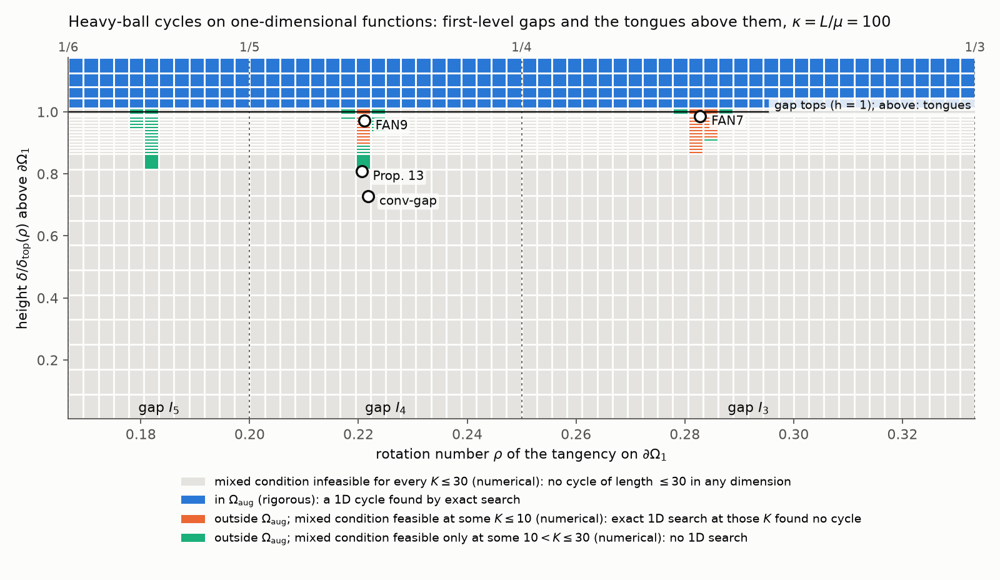

# hb1d-cycles: evidence for the one-dimensional consequence of the Fotopoulos et al. conjecture

**Do heavy-ball cycles exist on one-dimensional smooth strongly convex functions at parameters outside the
augmented root-of-unity region Ω_aug? Can Pasechnyuk-Vilensky's multi-harmonic fan orbits be realized by a
scalar function?**

This repository answers both questions **in the negative at every tuning and cycle length it examines**, with
exact certificates, and finds **no counterexample**. Nothing here proves the conjecture: one 1D cycle outside
Ω_aug would refute it, and no number of cases without one can prove it.

## 1. The question

Heavy ball, x_{k+1} = x_k − α f′(x_k) + β(x_k − x_{k−1}), on F_{μ,L}(ℝ) (μ-strongly convex, L-smooth, L = 1,
κ = L/μ).

* **Fotopoulos, Helcig, Deck, Alsbach**, *Non-Acceleration of the Heavy-Ball Method in 1D*, arXiv 2610.25104
  (18 Oct 2026). They prove Ω_aug ⊆ Ω_cyc^(1), so every tuning in Ω_aug (the union of the m-jump root-of-unity
  regions Ω_{K,m}) has a 1D cycle, and Ω_aug ⊊ Ω_Cycle (example P₁ in ℝ⁴). They **conjecture
  Ω_aug = Ω_cyc^(2)**. Since Ω_cyc^(1) ⊆ Ω_cyc^(2), the conjecture implies that **every 1D cycle lies in Ω_aug**.
* **Pasechnyuk-Vilensky**, *Two Answers on Heavy-Ball Dynamics*, arXiv 2610.09912 (7 Oct 2026). In the
  first-level gaps of the phase diagram he finds fan tongues where no single-harmonic orbit exists but
  multi-harmonic periodic orbits do (Prop. 13: κ = 100, αL = 70471/31800, β = 6169/9900, a 13-periodic orbit in
  ℝ⁵ with harmonics 2/13 and 3/13). He states as open: "the realization of the fan orbits … by scalar functions
  is the corresponding question in dimension one".

The two questions meet: as Pasechnyuk-Vilensky notes after his Thm A, his single-harmonic region
{Θ(2πj/k) ≤ π/k} is exactly Ω_aug (the one-line reason is in [docs/method.md §4](docs/method.md), checked here in
SymPy). So the fan tongues lie outside Ω_aug, and a 1D fan orbit would refute the conjecture.

## 2. Results

Tags: **[exact]** = verified by exact rational arithmetic (`fractions.Fraction`) or, where cosines of 2π/K occur,
by interval arithmetic with outward rounding (mpmath, 256 bits); **[numerical]** = floating-point LP/MILP
verdicts. Every "no cycle" below is the strongest form: it covers cycles with distinct points, with repeated
points and with slopes equal to μ or L, and all orbits whose period divides K ([docs/method.md §1](docs/method.md)).

### 2.1 Gate: the gap tunings are outside Ω_aug [exact]

`hb1d.regions.omega_aug_report` implements Fotopoulos et al.'s Lemma 3.1 and their Appendix B uniform bound. It
reproduces their Table 1 (13 rows, 9 digits), the Appendix B interval and K₀ = 10 at P₁ exactly, and Example 3.2
(in Ω_{5,2}, not in Ω_rou). It certifies that Prop. 13, conv-gap and the two fan tunings below lie **outside
Ω_aug**: every length K ≥ K₀ is excluded by the uniform bound and every primitive mode with K < K₀ has a
certified negative margin (Prop. 13: K₀ = 28, largest margin −0.00155 at (K, m) = (5, 1)).

### 2.2 Main table

| tuning (κ = L/μ) | αL | β | in Ω_aug | 1D result | how |
|---|---|---|---|---|---|
| **Prop. 13** (κ = 100), 13-cycle in ℝ⁵ | 70471/31800 | 6169/9900 | no | **no 1D cycle of any length K ≤ 25** [exact] | exact search K = 3..14; mixed condition infeasible for every other K ≤ 25 (and at K = 14, where both agree) |
| conv-gap (κ = 100), converges | 111/50 | 31/50 | no | no cycle of length K ≤ 40 in any dimension [exact] | mixed condition; exact 1D search K = 3..12 agrees |
| **FAN7** (κ = 100), 2/7 fan tongue, gap I₃ | 34/13 | 312/665 | no | **no 1D cycle for K ≤ 13** [exact] | exact search K = 3..13 |
| **FAN9** (κ = 100), 2/9 fan tongue, gap I₄ | 2201/986 | 199/320 | no | **no 1D cycle for K ≤ 16** [exact] | exact search K = 3..14; mixed infeasible at 15, 16 |
| **P₁** of Fotopoulos et al. (κ = 10⁴/531), cycle in ℝ⁴ | 32829/12500 | 4879/10000 | no | **no 1D cycle for K ≤ 13** [exact] | exact search K = 10, 13; mixed infeasible otherwise |
| Polyak (κ = 100) | 400/121 | 81/121 | yes (3-tongue) | 1D cycles for every K = 3..8 [exact] | rational certificates |
| Example 3.2 of Fotopoulos et al. (κ = 5/4) | 18/5 | 17/20 | yes (Ω_{5,2}) | 1D 5-cycle [exact]; none for K = 3, 4, 6 | rational certificate |

FAN7 and FAN9 are found by `scripts/find_fan_tunings.py`. At both, the mixed condition of Fotopoulos et al.
holds strictly at the fan length with modes 1/k and 2/k, so a cycle exists in ℝ⁴ (their Prop. 5.1). They are
fan-tongue points in Pasechnyuk-Vilensky's own sense too: his program of Thm fan-div(a), including the
minimizer constraint, is strictly feasible there with harmonics 1/k and 2/k, and the dips lie in (1/4, 1/3) and
(1/5, 1/4), i.e. in the gaps I₃ and I₄ [numerical, margins 1.3·10⁻³ and 1.9·10⁻³]. They are
explicit rational points with two-harmonic higher-dimensional cycles and **no** 1D cycle of length ≤ 13.

At Prop. 13 the mixed condition (a necessary condition for a K-cycle in **every** dimension) is certified
feasible for K ≤ 60 only at K ∈ {13, 26, 35, 39, 44, 48, 52, 53, 56, 57} and certified infeasible at every
other K ≤ 60 [exact]. So the **first open length for a 1D cycle at Prop. 13 is K = 26**.

Raw records (nodes, pruned nodes, seconds, solver versions) are in `results/exact_search.jsonl`; the table is
regenerated by `scripts/summarize.py` (`results/summary.md`).

### 2.3 Phase diagram in one dimension, κ = 100 [numerical classification, exact 1D searches]



1,740 grid tunings in Pasechnyuk-Vilensky's unrolled coordinates over the gaps I₃, I₄, I₅ (60 columns in the
rotation number ρ × 29 heights, finer near the tops of the gaps; `scripts/phase_diagram.py`, about 10 minutes
on 3 cores). Each cell is a rational tuning (denominators ≤ 10⁵):

| cell class | cells | 1D result |
|---|---|---|
| in Ω_aug (the K-tongues, K = 3..6, above the gaps) | 240 | a 1D cycle in **every** cell, of exactly the predicted minimal period K [exact] |
| outside Ω_aug, mixed condition feasible at some K ≤ 10 (fan tongues 2/7, 2/9, 3/10, …) | 34 | **no 1D cycle** in any of the 36 exact searches (K = 7, 9, 10) [exact] |
| outside Ω_aug, mixed condition feasible only at 10 < K ≤ 30 (e.g. around Prop. 13, K = 13) | 39 | not searched on the grid |
| mixed condition infeasible for all K ≤ 30 | 1,427 | no cycle of length ≤ 30 in any dimension [numerical] |

So on this grid the 1D cycles are exactly the Ω_aug cells, which is what Fotopoulos et al.'s Thm 4.1 gives on
one side and their conjecture predicts on the other. Cell classes are floating-point verdicts; the 1D searches
inside the cells are exact. The named tunings (circles) are separate points with their own results in §2.2;
the neighbouring cells are different tunings. Pasechnyuk-Vilensky's `dmivilensky/Heavy-Ball` already classifies
these gaps in unrestricted dimension; the new part here is the one-dimensional column.

### 2.4 Validation against known results (all in `tests/`)

| known result | source | check |
|---|---|---|
| Table 1, Appendix B interval, sin²_min, K₀ = 10 at P₁ | Fotopoulos et al. | reproduced exactly |
| Example 3.2 in Ω_{5,2} \ Ω_rou; p₂(1−p₂)−q₂² = (17215√5−36285)/10368; min h = 63/500 | Fotopoulos et al. | SymPy-exact |
| Thm 4.1 projected 5-cycle at Example 3.2 | Fotopoulos et al. | slopes strictly inside [μ, L] (independent oracle) |
| P₁ weights s₂ = 137/500, s₃ = 363/500 strictly mixed-feasible | Fotopoulos et al. eq. (5.6) | interval arithmetic |
| Prop. 13 spectrum 149/797 at 2/13, 648/797 at 3/13 feasible; fails at conv-gap | Pasechnyuk-Vilensky | fan program with our Θ |
| GTD's h(αμ, c) = (μ/L)·𝓛(c); Θ(2πm/K) = −arg M_m + arg(1 − M_m) | Pasechnyuk-Vilensky eq. (gtd) | numerical, SymPy |
| Polyak κ = 100: 3-cycle −1 → 0 → 1 | Liu et al. 2610.10369, App. H | exact |
| Polyak κ = 100: tied 5-cycle (1, 0, −1, −δ/β, 1), δ = 1 − β | Hernanz, Thm "fails from rest" | exact (tie branch) |
| No cycle in any dimension at (q, a, b) = (1/100, 113/50, 3/5) | F. Wang, Trace231/heavyball-blog | mixed infeasible K ≤ 40 (notation assumed) |
| MILP and exact search agree on small K | Phase 1 spike | 6 cases |

## 3. Method in one paragraph

A 1D K-cycle forces its gradients, g = Gx with a circulant rational G, and in one dimension interpolation by
F_{μ,L}(ℝ) is a set of slope conditions on consecutive sorted points. So a cycle exists iff one of (K−1)!
linear systems is feasible. We search the sorted orders by branch and bound; a branch is cut only when an
**exact rational Farkas certificate** of infeasibility has been verified, and any cycle found is rebuilt as an
exact rational vertex and checked. Long lengths are filtered first by the **mixed condition** of Fotopoulos et
al., a necessary condition for K-cycles in every dimension whose infeasibility we certify by interval arithmetic.
Details, the big-M derivation of the auxiliary MILP and the phase-diagram coordinates are in
[docs/method.md](docs/method.md).

## 4. What this does not show

* It does **not** prove the conjecture, nor its 1D consequence. The evidence is finite: named tunings, lengths
  K ≤ 14 by search (≤ 25 at Prop. 13 with the filter), and a grid with K ≤ 10.
* At Prop. 13, lengths K = 26, 35, … are open in 1D; K = 26 is out of reach of the present search
  (the tree grows about 3× per unit of K).
* Nothing is claimed in dimension 2. Existence of a 1D cycle outside Ω_aug would refute the conjecture; its
  absence says nothing about 2D.
* The phase-diagram cell labels come from floating-point classification; only the 1D searches inside cells are
  exact.

## 5. Related work

* B. Goujaud, A. Taylor, A. Dieuleveut, *Provable non-accelerations of the heavy-ball method*, Math. Program.
  (2025), arXiv 2307.11291: root-of-unity cycles in ℝ², Ω_rou, the LP characterization of general cycling.
* B. Goujaud et al., *Open Problem: Two Riddles in Heavy-Ball Dynamics*, COLT 2025, arXiv 2502.19916: fractional
  sets; the 1D question.
* K. Fotopoulos, M. Helcig, K. Deck, J. Alsbach, arXiv 2610.25104, and their Lean repository
  `kostfoto/Non-Acceleration-Heavy-Ball-1D` (no computational search of Ω_cyc^(1); no commits since 17 Oct 2026).
  Their acknowledgments mention that Dieuleveut and collaborators concurrently resolved 1D non-acceleration
  (unpublished as of 21 Oct 2026).
* D. Pasechnyuk-Vilensky (arXiv's spelling; the paper itself writes Pasechniuk-Vilensky), arXiv 2610.09912, and `dmivilensky/Heavy-Ball`, which **already classifies the κ = 100
  first-level gaps without a dimension restriction**; our diagram adds the 1D question on top of it.
* K. Liu, Q. Wu, Z. Sun, M. Chen, S. Li, B. Qu, *Sharp Initialization Guarantees for the Heavy-Ball Method*,
  arXiv 2610.10369: App. F (single-harmonic 1D cycles, global non-acceleration for κ ≥ 24), App. H (attracting
  3-cycle at Polyak's tuning, κ = 100).
* M. Hernanz, *The Optimal Rate Constant of Heavy-Ball Momentum on Smooth Strongly Convex Functions* (alphaXiv,
  Oct 2026), `marcoshernanz/heavy-ball-optimal-rate`: App. D, results in one dimension, including an exact
  **two-harmonic** 1D 5-cycle with a repeated point at Polyak's tuning. That cycle is inside Ω_aug, so a
  multi-harmonic 1D cycle by itself is not new; the question here is about tunings outside Ω_aug.
* Lessard, Recht, Packard (2016); Taylor, Van Scoy, Lessard (2018); Badithela, Seiler (ACC 2019): Lyapunov and
  IQC convergence regions, the 3-cycle at Polyak's tuning.
* Control side: P. Seiler, J. Carrasco, *Construction of periodic counterexamples to the discrete-time Kalman
  conjecture*, IEEE L-CSS 5(4), 2021 (single-frequency 1D construction, the analogue of Fotopoulos et al.'s
  projection); J. Zhang, J. Carrasco, W. P. Heath, *Duality bounds for discrete-time Zames–Falb multipliers*,
  IEEE TAC 67(7), 2022, who state that the meaning of the multiple-frequency condition "is still open";
  A. Kharitenko, arXiv 2607.23599 (read at abstract level), a numerical example where every O'Shea–Zames–Falb
  test fails but the scalar Lur'e system is stable.

The literature check (channels, queries, verdicts) is logged in
[docs/literature-check-2026-10-21.md](docs/literature-check-2026-10-21.md).

## 6. Reproduce

```bash
python -m venv .venv && .venv/bin/pip install -e ".[test]"
.venv/bin/python -m pytest -q          # about 2 minutes
./reproduce.sh                         # fast part; FULL=1 ./reproduce.sh reruns the long searches (hours)
```

Python ≥ 3.11, NumPy, SciPy (HiGHS), mpmath, SymPy, Matplotlib. Results were computed with Python 3.13.5 and
SciPy 1.18.1 on an Apple M1.

## 7. ملخص بالعربية

**السؤال:** هل توجد دورات لطريقة Heavy Ball على دوال ذات بعد واحد عند معاملات خارج المنطقة Ω_aug؟ وهل يمكن
تحقيق مدارات «المروحة» متعددة التوافقيات عند Pasechnyuk-Vilensky بدالة ذات بعد واحد؟ وجود دورة واحدة كهذه
يدحض حدسية Fotopoulos وزملائه.

**النتيجة:** لم نجد أي مثال مضاد. كل ما يلي `[exact]`، أي بشهادات كسرية دقيقة أو بحساب فترات دقيق:
* معاملات Prop. 13 خارج Ω_aug، ولا توجد لها دورة في بعد واحد بأي طول K ≤ 25. الطول 13 بالبحث الدقيق،
  والأطوال الأخرى لأن الشرط المختلط (شرط لازم في كل الأبعاد) غير ممكن. أول طول مفتوح هو 26.
* نقطتان جديدتان داخل لساني المروحة 2/7 و2/9 عند κ = 100: لهما دورات في ℝ⁴، ولا دورة في بعد واحد بطول
  ≤ 13 و≤ 16 على الترتيب.
* النقطة P₁ عند Fotopoulos (دورة في ℝ⁴): لا دورة في بعد واحد بطول ≤ 13.
* مخطط طور في بعد واحد لفجوات المستوى الأول عند κ = 100 (1,740 خلية): الدورات في بعد واحد تظهر في خلايا Ω_aug
  كلها (240 خلية) ولا تظهر في أي خلية من خلايا المروحة (34 خلية). التصنيف عددي، والبحث داخل كل خلية دقيق.

**ما لا تثبته هذه النتائج:** لا تثبت الحدسية. هي أدلة محدودة بأطوال ونقاط معينة، ولا تقول شيئاً عن بعدين.

## 8. Citation and license

See `CITATION.cff`. Apache-2.0.
